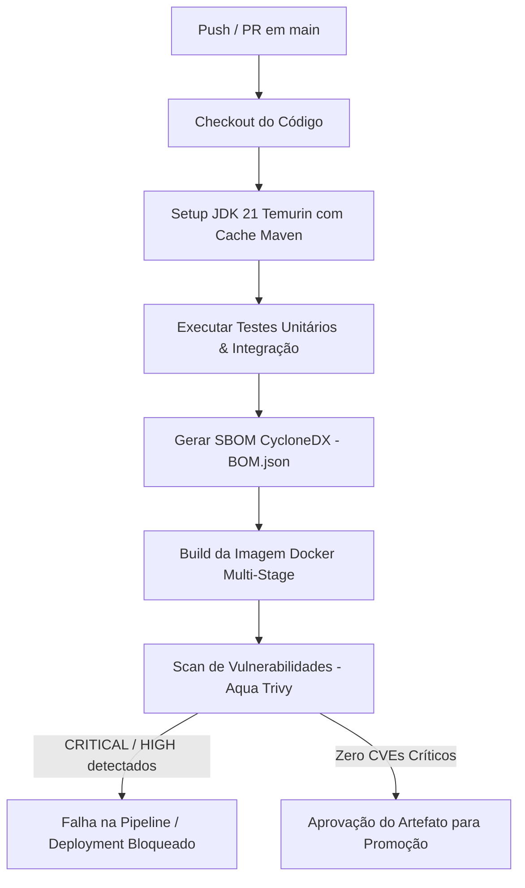

# 🚀 Serviço de Checkout: Engenharia de Release, Containers & Zero-Downtime

Este projeto é uma implementação de referência de um serviço de **Checkout** resiliente e seguro, projetado com foco em arquitetura de microsserviços, **Engenharia de Release**, empacotamento OCI seguro, auditoria de vulnerabilidades em esteiras CI/CD e evolução de banco de dados sem downtime (*Zero-Downtime Deploy*) através do padrão **Expand and Contract**.

---

## 📂 Estrutura do Repositório (`desafio/`)

```text
desafio/
├── .github/
│   └── workflows/
│       └── ci.yml                 # Pipeline GitHub Actions (Build, Testes, SBOM e Trivy)
├── src/
│   └── main/
│       ├── java/
│       │   └── com/
│       │       └── adatest/
│       │           └── checkout/
│       │               ├── CheckoutApplication.java
│       │               ├── controller/
│       │               │   └── PagamentoController.java
│       │               ├── domain/
│       │               │   ├── Pagamento.java
│       │               │   └── StatusPagamento.java
│       │               └── repository/
│       │                   └── PagamentoRepository.java
│       └── resources/
│           ├── application.yml
│           └── db/
│               └── migration/
│                   ├── V1__init_schema.sql
│                   ├── V2__expand_add_estado_saga.sql
│                   └── V3__backfill_estado_saga.sql
├── Dockerfile                      # Multi-Stage Build (Eclipse Temurin JDK 21 -> Distroless JRE 21)
├── docker-compose.yml              # Subida e orquestração local (PostgreSQL 16 + API)
├── pom.xml                         # Dependências Spring Boot & Plugin CycloneDX
└── README.md                       # Documentação do projeto
```

---

## 🛠️ Tecnologias e Decisões de Arquitetura

- **Linguagem & Framework:** Java 21 LTS com Spring Boot 3.2.x e Spring Data JPA.
- **Banco de Dados:** PostgreSQL 16.
- **Gerenciamento de Migrações:** Flyway com versionamento sequencial imutável.
- **Empacotamento OCI Seguro:** Multi-stage build utilizando **Google Distroless (`gcr.io/distroless/java21-debian12:nonroot`)** como imagem final. Não contém shell, pacotes desnecessários ou usuário `root`, mitigando execuções arbitrárias de código.
- **Segurança & Governança (DevSecOps):** 
  - **CycloneDX Maven Plugin**: Geração automática de SBOM (*Software Bill of Materials*).
  - **Aqua Trivy Scanner**: Análise estática no pipeline buscando vulnerabilidades de severidade `CRITICAL` e `HIGH` na imagem container.
- **Zero-Downtime Database Migration:** Aplicação do padrão *Expand and Contract* com suporte a *Dual Write* no modelo domain.

---

## 🏗️ Arquitetura de Sistemas & Engenharia de Release

### 1. Fluxo do Pipeline de CI/CD (GitHub Actions)



---

### 2. Padrão Zero-Downtime Migration (*Expand-Contract*)

Para garantir atualização contínua sob alto volume de transações por segundo (TPS), o banco de dados PostgreSQL evolui sem travar tabelas nem quebrar requisições ativas:

```text
+-----------------------------------------------------------------------------------+
| FASE 1: EXPAND (V2)                                                               |
| • Flyway adiciona coluna 'estado_saga' como NULLABLE.                            |
| • Aplicação v1 continua rodando e escrevendo em 'status_pagamento'.               |
+-----------------------------------------------------------------------------------+
                                          │
                                          ▼
+-----------------------------------------------------------------------------------+
| FASE 2: DUAL-WRITE & BACKFILL (V3)                                               |
| • Script de Backfill sincroniza registros legados no banco.                      |
| • Aplicação v2 entra em execução realizando Dual-Write nas duas colunas.         |
| • Rollback seguro mantido (versão v1 lê 'status_pagamento' se necessário).         |
+-----------------------------------------------------------------------------------+
                                          │
                                          ▼
+-----------------------------------------------------------------------------------+
| FASE 3: CONTRACT (Futuro V4)                                                     |
| • 100% das instâncias migradas para v2.                                           |
| • Coluna 'status_pagamento' descontinuada e removida via migração assíncrona.    |
+-----------------------------------------------------------------------------------+
```

---

### 3. Hardening de Containers & Observabilidade

- **Multi-Stage Build:** Separação do ambiente de compilação da imagem de execução final.
- **Imagem Distroless:** Imagem enxuta sem gerenciadores de pacote (`apt`) ou shell (`/bin/sh`), reduzindo a superfície de ataque.
- **Execução não-root:** Execução restrita ao usuário `nonroot`.

---

## 🚀 Como Executar o Projeto Localmente

### Pré-requisitos
- Docker Engine e Docker Compose instalados.

### 1. Inicializar Infraestrutura e Aplicação
Dentro da pasta `desafio/`, execute:

```bash
docker compose up --build -d
```

### 2. Validar Healthcheck (Smoke Test)
```bash
curl -i http://localhost:8080/api/pagamentos/healthz
```

**Resposta esperada:**
```json
{"service":"checkout-service","status":"UP"}
```

### 3. Testar a Criação e Listagem de Pagamentos
- **Criar Pagamento:**
  ```bash
  curl -X POST "http://localhost:8080/api/pagamentos?valor=250.50"
  ```

- **Listar Pagamentos:**
  ```bash
  curl http://localhost:8080/api/pagamentos
  ```

---

## 📊 Métricas de Operação (SLO / SLI)

| Métrica | Objetivo de Nível de Serviço (SLO) | Indicador (SLI) |
| :--- | :--- | :--- |
| **Disponibilidade durante Deploy** | 99.99% Uptime | Endpoint `/healthz` via Actuator |
| **Tempo de Deployment** | < 3 minutos na pipeline | Duração do job no GitHub Actions |
| **Vulnerabilidades de Imagem** | 0 Vulnerabilidades `CRITICAL` / `HIGH` | Relatório do Trivy Scanner |