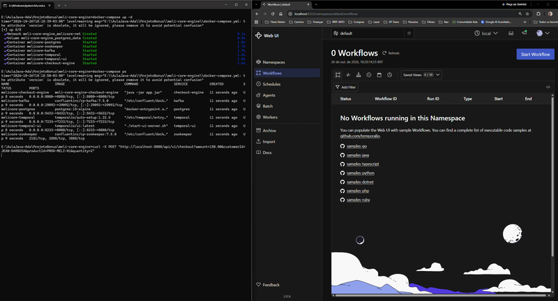
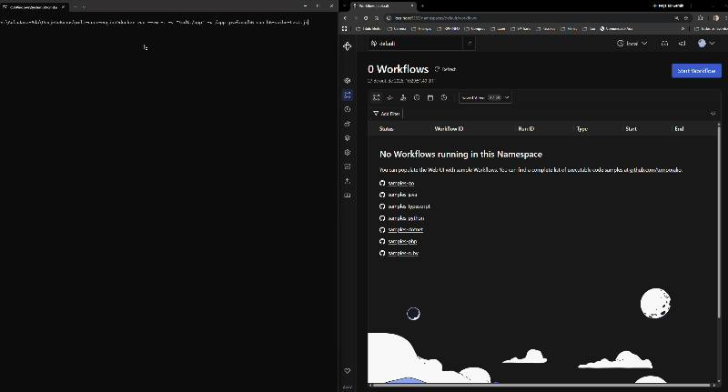

# MeliCore Checkout Engine

Um sistema de checkout de microsserviços de alto desempenho, resiliente e orientado a eventos, construído com Spring Boot, Temporal.io, PostgreSQL e Apache Kafka. O projeto implementa orquestração de transações distribuídas usando o **Padrão SAGA** e garante a entrega confiável de eventos via **Padrão Transactional Outbox**.

---

## 📌 Sumário
- [Descrição](#-descrição)
- [Demonstração em Ação](#-demonstração-em-ação)
- [Tecnologias Utilizadas](#-tecnologias-utilizadas)
- [Arquitetura](#-arquitetura)
- [Preparação para Alta Volumetria (Cenário Black Friday)](#-preparação-para-alta-volumetria-cenário-black-friday)
- [Estrutura de Pastas](#-estrutura-de-pastas)
- [Guia de Execução Passo a Passo](#-guia-de-execução-passo-a-passo)
- [Execução dos Testes Integrados, Unitários e de Carga](#-execução-dos-testes-integrados-unitários-e-de-carga)
- [Visualização de Ordens Processadas (Portal Temporal)](#-visualização-de-ordens-processadas-portal-temporal)
- [Trade-offs de Arquitetura](#-trade-offs-de-arquitetura)
- [Resolução de Problemas (Troubleshooting)](#-resolução-de-problemas-troubleshooting)

---

## 📖 Descrição

O **MeliCore Checkout Engine** processa fluxos de checkout de e-commerce sob garantias de alta resiliência e consistência transacional. 

Ele resolve o problema de escrita dupla (*dual-write problem*) entre fronteiras de microsserviços combinando:
1. **Temporal.io** para orquestração de workflows SAGA baseada em estado (Reserva de Estoque $\rightarrow$ Processamento de Pagamento $\rightarrow$ Geração da Etiqueta de Envio) com ações de compensação automáticas em caso de falhas.
2. **Padrão Transactional Outbox** com PostgreSQL para persistir eventos de negócio e mensagens de saída de forma atômica dentro de uma única transação de banco de dados.
3. **Outbox Poller & Apache Kafka** para distribuição assíncrona e confiável de eventos para serviços consumidores, contando com suporte a **Dead Letter Queue (DLQ)** para falhas não recuperáveis de publicação.

---

## 🎥 Demonstração em Ação

Abaixo estão os registros visuais do comportamento e da observabilidade do motor SAGA sob cenários funcionais e de estresse:

### 1. Teste Funcional Isolado (Fluxo de Ordem Única)
Demonstração do processamento de uma requisição individual de checkout via API, permitindo rastrear passo a passo a execução da SAGA no painel do Temporal UI.

<p align="center">
  
</p>

### 2. Teste de Carga & Alta Concorrência em Lote (k6)
Demonstração da resiliência da arquitetura assíncrona (`WorkflowClient.start` respondendo `202 Accepted`). À esquerda, o **k6** injeta picos de carga com até 50 VUs; à direita, o **Temporal Web UI** acompanha a transição dinâmica e massiva das SAGAs do estado limpo para `RUNNING` e `COMPLETED` em tempo real sem degradação do sistema.

<p align="center">
  
</p>

---

## 🛠 Tecnologias Utilizadas

* **Linguagem / Framework**: Java 17, Spring Boot 3.x, Spring Data JPA, Spring Kafka
* **Orquestração de Workflows**: Temporal.io (Java SDK)
* **Banco de Dados & Migração**: PostgreSQL 15, Flyway, H2 Database (em memória para testes)
* **Mensageria & Streaming**: Apache Kafka, Embedded Kafka (para testes), Zookeeper
* **Containerização**: Docker, Docker Compose
* **Observabilidade & Resiliência**: Resilience4j, OpenTelemetry (OTLP)
* **Testes & Carga**: JUnit 5, Embedded Kafka, Spring Boot Test, k6 (Grafana)

---

## 🏗 Arquitetura

```
+---------------------------------------------------------------------------------+
|                             HTTP Client / k6 Load Test                          |
+---------------------------------------------------------------------------------+
                                         | HTTP POST /api/v1/checkout
                                         v
+---------------------------------------------------------------------------------+
|                        Spring Boot API (MeliCore Service)                       |
|  - Resilience4j (@CircuitBreaker / Fallbacks)                                  |
|  - Flyway (Migrações de Banco de Dados)                                         |
|  - OpenTelemetry (Traces & Métricas)                                           |
+------------------+------------------------------------+-------------------------+
                   |                                    |
                   v (Transação de Banco)                v (Workflow SAGA Assíncrono)
+------------------------------------+    +---------------------------------------+
|        PostgreSQL Database         |    |              Temporal.io              |
|  - Tabela: orders                  |    |  - Workflow: OrderWorkflow            |
|  - Tabela: outbox_events           |    |  - Activities: ReserveStock,          |
+------------------+-----------------+    |    ProcessPayment, GenerateShipping   |
                   |                      |  - Compensações Automáticas           |
                   | (Polling @Scheduled) +---------------------------------------+
                   v
+------------------------------------+
|          Outbox Poller             |
|  - Lê eventos pendentes            |
|  - Despacha para o Kafka           |
|  - Atualiza `processed = true`     |
+------------------+-----------------+
                   |
                   v
+------------------------------------+
|            Apache Kafka            |
|  - Tópico: orders.events           |
|  - Tópico: orders.dlq (Dead Letter)|
+------------------------------------+
```

### Padrões de Projeto Chave
* **Padrão SAGA (Baseado em Orquestrador)**: Gerenciado pelo Temporal.io. Coordena sequencialmente atividades distribuídas e executa ações de compensação caso qualquer etapa falhe.
* **Padrão Transactional Outbox**: Evita a inconsistência de dados causada por falhas parciais ao gravar no banco de dados e publicar simultaneamente num broker de mensagens.

---

## ⚡ Preparação para Alta Volumetria (Cenário Black Friday)

O **MeliCore Checkout Engine** foi projetado especificamente para suportar cenários de altíssima concorrência e picos de tráfego intensos (como a Black Friday operando a 5.000+ TPS), endereçando diretamente os principais vetores de falha em sistemas distribuídos:

* **Proteção contra Falhas de Terceiros e Indisponibilidade**: Em picos de vendas, gateways de pagamento externos ou serviços de estoque podem apresentar alta latência ou instabilidade. A orquestração do **Temporal.io** garante resiliência através de retentativas automáticas (*backoff*) e execução imutável de transações compensatórias em SAGA (ex: estornos e reversões automáticas de reservas) caso o fluxo falhe em qualquer etapa intermediária.
* **Eliminação do Problema de *Dual-Write***: Ao persistir a alteração do pedido e o evento correspondente dentro da mesma transação relacional PostgreSQL utilizando o **Padrão Transactional Outbox**, o sistema assegura atomicidade: nenhum evento de checkout é perdido antes de ser entregue ao broker, mesmo diante de falhas de rede ou reinicialização dos containers.
* **Desacoplamento e Escala Assíncrona**: O desacoplamento do `OutboxPoller` em conjunto com o **Apache Kafka** isola a escrita síncrona de baixa latência da API das rotinas de processamento assíncrono dos consumidores, protegendo a aplicação contra a saturação do pool de conexões HTTP e do banco de dados.
* **Diagnóstico e Observabilidade em Produção**: A instrumentação nativa com **OpenTelemetry** gera correlação de rastreio distribuído (`traceparent` W3C) ao longo dos microsserviços e eventos assíncronos, permitindo aos times de SRE identificar rapidamente gargalos de latência (p99) e saturação de recursos (Métricas RED/USE).

---

## 📁 Estrutura de Pastas

```text
ProjetoBonus/
├── docs/
│   ├── demo-melicore.gif
│   └── demo-melicore-part2.gif
├── README.md
└── meli-core-engine/
	├── .dockerignore
	├── Dockerfile
	├── docker-compose.yml
	├── k6-spike-test.js
	├── pom.xml
	└── src/
		├── main/
		│   ├── java/
		│   │   └── com/
		│   │       └── melicore/
		│   │           └── engine/
		│   │               ├── CheckoutEngineApplication.java
		│   │               ├── config/
		│   │               │   ├── KafkaConfig.java
		│   │               │   ├── KafkaTopicConfig.java
		│   │               │   ├── OpenTelemetryConfig.java
		│   │               │   └── TemporalConfig.java
		│   │               ├── controller/
		│   │               │   └── CheckoutController.java
		│   │               ├── domain/
		│   │               │   ├── Order.java
		│   │               │   └── OutboxEvent.java
		│   │               ├── repository/
		│   │               │   ├── OrderRepository.java
		│   │               │   └── OutboxRepository.java
		│   │               ├── scheduler/
		│   │               │   └── OutboxPoller.java
		│   │               └── saga/
		│   │                   ├── OrderWorkflow.java
		│   │                   ├── OrderWorkflowImpl.java
		│   │                   ├── OrderActivities.java
		│   │                   └── OrderActivitiesImpl.java
		│   └── resources/
		│       ├── application.properties
		│       └── db/
		│           └── migration/
		│               └── V1__create_outbox_and_orders_tables.sql
		└── test/
			├── java/
			│   └── com/
			│       └── melicore/
			│           └── engine/
			│               ├── CheckoutEngineApplicationTests.java
			│               └── OutboxPollerTest.java
			└── resources/
				└── application-test.properties
```

---

## 🚀 Guia de Execução Passo a Passo

### Pré-requisitos
* Docker Engine 20.10+ e Docker Compose v2+ instalados.
* `curl` ou qualquer cliente API (Postman, Insomnia).

### 1. Limpar e Subir a Infraestrutura
Compile e inicie todos os serviços containerizados (PostgreSQL, Kafka, Zookeeper, Temporal e Spring Boot):

```bash
# Limpa volumes antigos e sobe o ecossistema completo
docker-compose down -v
docker-compose up --build -d
```

### 2. Verificar a Saúde dos Contentores
Certifique-se de que todos os contentores estão com estado **Up**:

```bash
docker-compose ps
```

Contentores esperados:
* `melicore-checkout-engine` (Porta `8080`)
* `melicore-postgres` (Porta `5432`)
* `melicore-kafka` (Porta `29092`)
* `melicore-zookeeper` (Porta `2181`)
* `melicore-temporal` (Porta `7233`)
* `melicore-temporal-ui` (Porta `8233`)

### 3. Confirmar Criação Automática dos Tópicos no Kafka
Valide se os tópicos `orders.events` e `orders.dlq` foram criados no broker:

```bash
docker exec -it melicore-kafka kafka-topics --bootstrap-server localhost:29092 --list
```

### 4. Executar o Teste do Checkout Ponta a Ponta (E2E)
Dispare uma transação isolada de checkout via `curl` utilizando o payload JSON:

```bash
curl -X POST http://localhost:8080/api/v1/checkout \
  -H "Content-Type: application/json" \
  -d '{
    "amount": 150.00,
    "customerId": "JEAN-BARBOSA",
    "productId": "PROD-MELI-01",
    "quantity": 2
  }'
```

---

## 🧪 Execução dos Testes Integrados, Unitários e de Carga

### 1. Testes Automatizados (Unidade e Integração)

O projeto conta com uma suíte de testes automatizada que valida o carregamento do contexto da aplicação, persistência de dados e a publicação de mensagens via **Transactional Outbox**.

#### Isolamento do Ambiente de Testes
* **Perfil `@ActiveProfiles("test")`**: Utiliza as configurações isoladas em `src/test/resources/application-test.properties`.
* **Banco de Dados em Memória (H2)**: Substitui o PostgreSQL real durante os testes.
* **Kafka Embarcado (`@EmbeddedKafka`)**: Inicia um broker de Kafka em memória para validar o envio/consumo dos tópicos.
* **Temporal Silenciado**: O registo de workers do Temporal é condicionado via `@ConditionalOnProperty(name = "temporal.worker.enabled", havingValue = "true")`.

#### Como Executar via Terminal:
```bash
./mvnw test
```

---

### 2. Teste de Carga em Lote (k6 Spike Test via Docker)

Para simular o cenário de alta concorrência da Black Friday e validar a resiliência do processamento assíncrono das SAGAs no Temporal:

```bash
docker run --rm -i \
  --add-host=host.docker.internal:host-gateway \
  grafana/k6 run - < k6-spike-test.js
```

> **Nota de Performance**: O script de estresse injeta múltiplos VUs (até 50 usuários virtuais simultâneos). Por o endpoint ser assíncrono (`202 Accepted`), a API responde de imediato enquanto o Temporal gerencia a fila `CHECKOUT_TASK_QUEUE` em segundo plano sem travar o servidor.

---

## 🖥 Visualização de Ordens Processadas (Portal Temporal)

Todas as ordens e workflows SAGA processados podem ser inspecionados em tempo real através do portal Web do **Temporal.io**:

1. Acesse no seu navegador: **`http://localhost:8233`**
2. No menu principal, clique em **Workflows**.
3. Na lista, você encontrará o fluxo `OrderWorkflow` registrado com o **Workflow ID** (ex: `order-756e3a35-fa08-49e0-a413-bee8db9be541`).
4. **Status das Ordens**:
   * **`COMPLETED`**: A ordem foi processada com sucesso por todas as etapas (Estoque $\rightarrow$ Pagamento $\rightarrow$ Envios).
   * **`RUNNING`**: O workflow está atualmente em execução ou na fila de processamento.
   * **`FAILED` / `TERMINATED`**: Ocorreu uma falha no fluxo e as compensações de SAGA foram acionadas.
5. Clique sobre qualquer ID de workflow para visualizar o histórico detalhado de eventos, parâmetros de entrada/saída, tempos de resposta de cada atividade e árvore de execução de compensação.

---

## ⚖ Trade-offs de Arquitetura

| Decisão Arquitetural | Prós | Cons / Trade-offs |
| :--- | :--- | :--- |
| **SAGA via Orquestração (Temporal.io)** | Estado do fluxo explícito, visibilidade centralizada no portal, retentativas nativas, facilidade em compensações. | Dependência de um cluster externo (Temporal Server) e curva de aprendizado para definição de workflows/atividades. |
| **Transactional Outbox via Poller (`@Scheduled`)** | Simplicidade de implementação, não exige plugins adicionais no banco, funciona nativamente com JPA/Flyway. | O polling contínuo gera um leve consumo de CPU e latência (intervalo do agendador). Exige idempotência nos consumidores (entrega *at-least-once*). |
| **Debezium CDC (Alternativa ao Poller)** | Zero overhead de polling no banco de dados, streaming em tempo real via logs WAL do PostgreSQL. | Maior complexidade operacional e necessidade de mais componentes de infraestrutura (Kafka Connect, instâncias do Debezium). |
| **Entrega At-Least-Once (Pelo menos uma vez)** | Garante que nenhum evento seja perdido em momentos de partição de rede ou quedas do broker. | Consumidores de mensagens **devem** ser idempotentes para lidar com eventos duplicados utilizando chaves únicas (UUID do pedido ou do evento). |

---

## 🔍 Resolução de Problemas (Troubleshooting)

### Problema 1: `curl: (7) Failed to connect to localhost:8080`
* **Causa**: A aplicação Spring Boot não iniciou ou ainda está em processo de inicialização no Docker.
* **Solução**: Verifique os logs com `docker-compose logs checkout-engine --tail=50` e aguarde a mensagem `Started CheckoutEngineApplication`.

### Problema 2: `Schema-validation: missing column [processed] in table [outbox_events]`
* **Causa**: A validação do Hibernate falhou porque o volume do PostgreSQL mantinha uma estrutura antiga da tabela sem a coluna `processed`.
* **Solução**: Limpe os volumes antigos do banco e suba a infraestrutura novamente:
  ```bash
  docker-compose down -v
  docker-compose up --build -d
  ```

### Problema 3: `Connection to postgres:5432 refused`
* **Causa**: O container do PostgreSQL ainda não estava pronto para aceitar conexões quando o Spring Boot iniciou o Flyway.
* **Solução**: Reinicie o container da aplicação:
  ```bash
  docker-compose restart checkout-engine
  ```
---

## 📝 Licença & Autoria 
* Projeto desenvolvido para fins educacionais e de demonstração de arquitetura de alta escala.
* **Autor**: Jean Barbosa ([@JTBCode86](https://github.com/JTBCode86)).